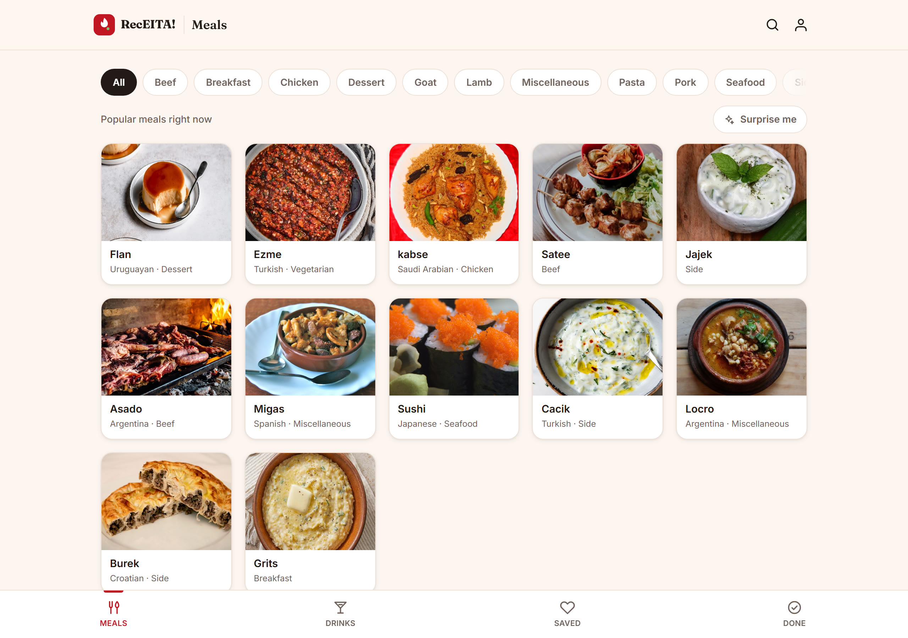
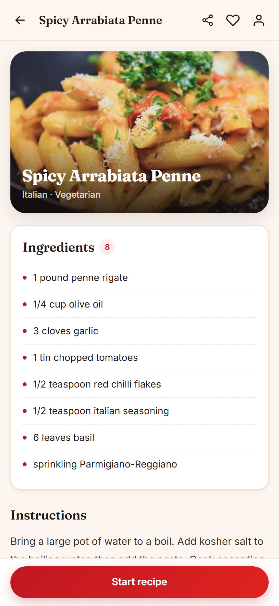
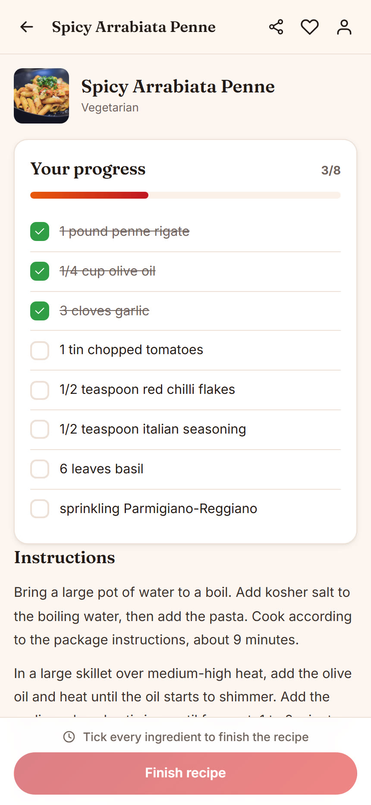
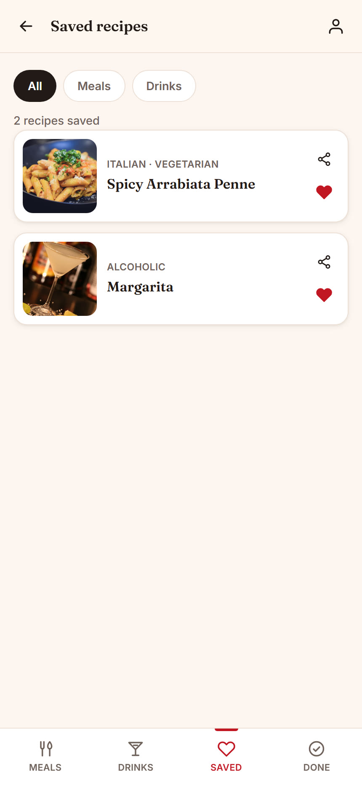
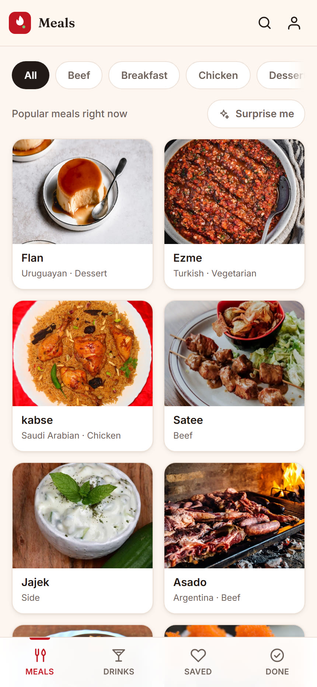
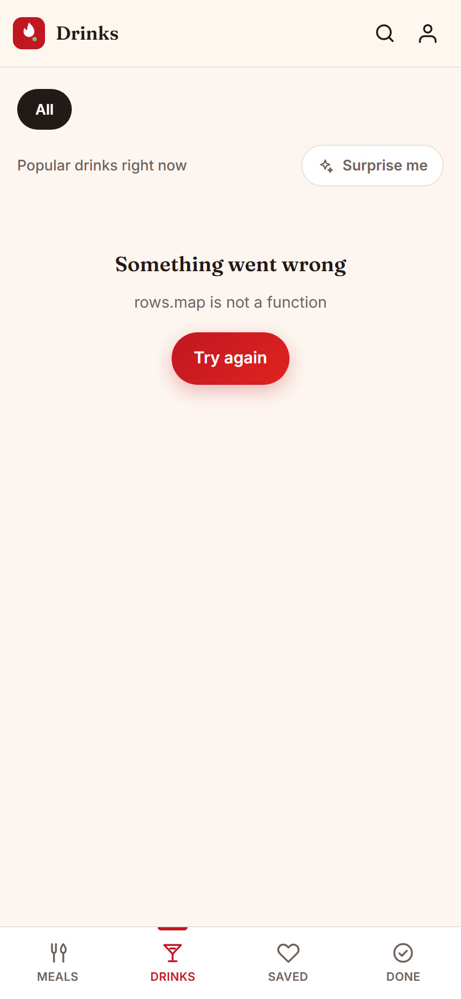
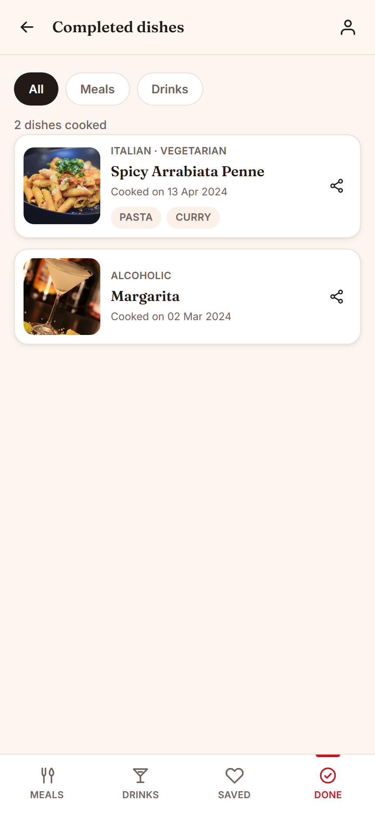
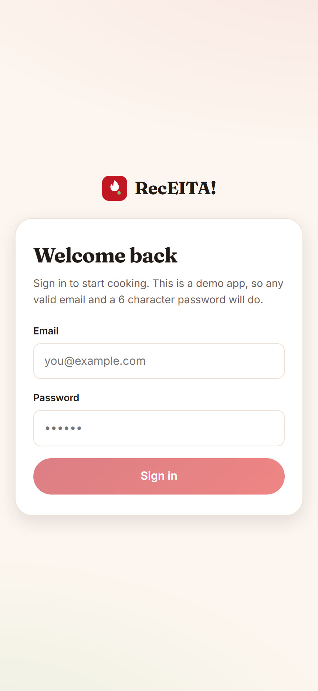
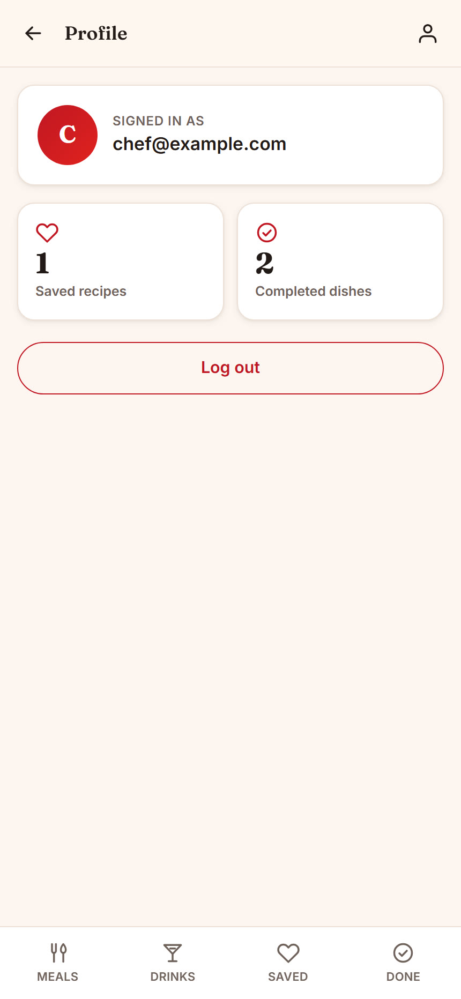
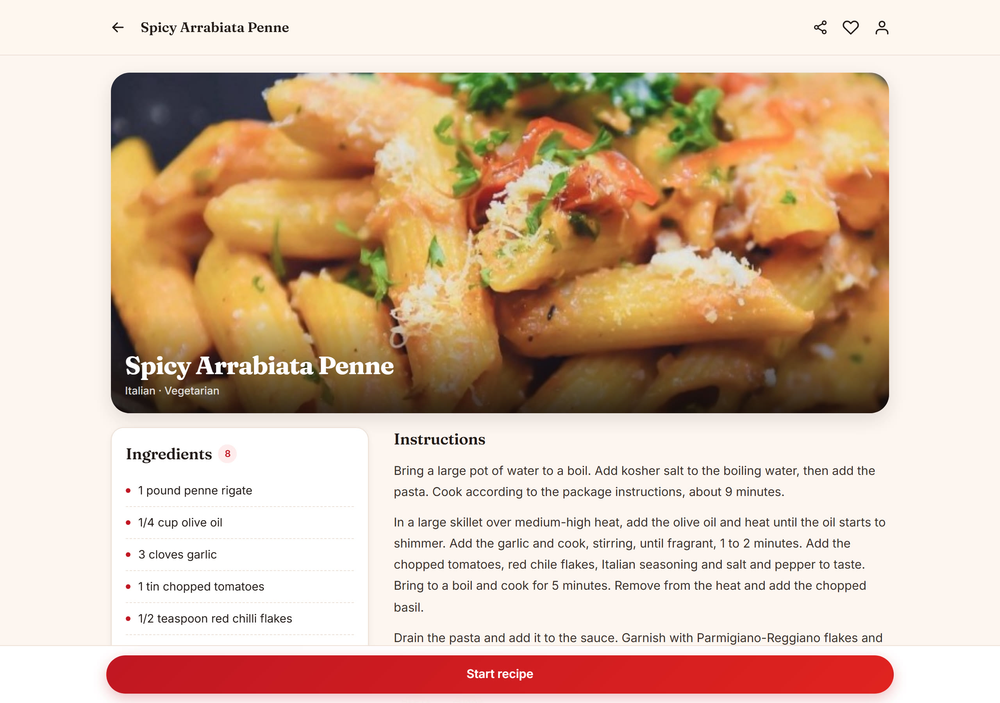

# RecEITA!

**Meals, cocktails and everything in between — search, cook and keep the recipes you love.**

A mobile-first recipe explorer built with React. It talks to [TheMealDB](https://www.themealdb.com/)
and [TheCocktailDB](https://www.thecocktaildb.com/), and keeps your favourites, cooking
progress and finished dishes in the browser, no account required.

[](https://receita.surge.sh)
[](LICENSE)
[](https://react.dev)
[](#testing)
[](#scripts)



## Table of contents

- [Features](#features)
- [Screenshots](#screenshots)
- [Tech stack](#tech-stack)
- [Architecture](#architecture)
- [Getting started](#getting-started)
- [Scripts](#scripts)
- [Testing](#testing)
- [Data and storage](#data-and-storage)
- [Deployment](#deployment)
- [What changed in 2.0](#what-changed-in-20)
- [Roadmap](#roadmap)
- [Contributors](#contributors)
- [License](#license)

## Features

**Discover**

- Browse the full catalogue of meals and cocktails, 12 cards per view, with a
  loading skeleton instead of a blank screen.
- Search by **name**, **ingredient** or **first letter**, with the exact same
  rules the APIs apply (a first-letter search really is one character).
- Filter by category with a single tap — tapping the active category or `All`
  takes you back to the full list.
- `Surprise me` jumps to a random recipe when you cannot decide.

**Cook**

- Full recipe page: photo, origin, category, ingredients with their measures,
  instructions split into readable steps and the matching YouTube video.
- Step-by-step cooking mode with a checklist, a live progress bar and
  strike-through for everything you already added to the pan.
- Progress survives a reload, a closed tab or a walk to the shop.
- `Finish recipe` unlocks only when every ingredient is ticked off, and files the
  dish under **Completed** with the date and its tags.

**Keep**

- Favourites, completed dishes and in-progress recipes, all persisted locally.
- Dedicated pages with `All / Meals / Drinks` filters, share buttons and a
  friendly empty state instead of a blank page.
- Real deep links: every recipe has its own URL, so sharing actually works.
- Six recommendations from the *other* database at the bottom of each recipe.

**Craft**

- Mobile-first layout, from a 360 px phone to a wide desktop, with a fixed
  bottom tab bar and a sticky primary action.
- Accessible by default: labelled icon buttons, `aria-pressed` toggles, a real
  `progressbar`, keyboard-friendly checkboxes and visible focus rings.
- Toasts instead of `window.alert`, inline validation instead of silent
  disabled buttons, and error states with a retry action.
- No UI framework: a small set of design tokens and hand-written CSS.

## Screenshots

| Recipe | Cooking mode | Saved recipes |
| :---: | :---: | :---: |
|  |  |  |

| Meals | Drinks | Completed |
| :---: | :---: | :---: |
|  |  |  |

| Login | Profile | Desktop recipe |
| :---: | :---: | :---: |
|  |  |  |

## Tech stack

| Layer | Choice |
| --- | --- |
| UI | React 18 (function components only) + hooks |
| Routing | React Router 5 (`react-router-dom`) |
| Global state | Context API + a reducer-free provider that owns the local library |
| Styling | Hand-written CSS with custom properties, no UI framework |
| Data | TheMealDB and TheCocktailDB public APIs |
| Persistence | `localStorage`, wrapped in a crash-proof helper |
| Tests | Jest + React Testing Library + user-event |
| Lint | ESLint (`eslint-config-react-app`) and Stylelint (standard config) |
| Build | Create React App 5 |

## Architecture

```
src/
├── components/          # reusable UI, no data fetching of its own
│   ├── Feedback.js      # empty / error / skeleton states and toasts
│   ├── Header.js        # sticky bar with the collapsible search
│   ├── RecipeBrowser.js # the shared meals & drinks browser
│   ├── RecipeCard.js
│   ├── SavedRecipeCard.js
│   ├── SearchBar.js
│   └── icons.js         # inline SVG icon set (no icon font)
├── context/             # AppProvider: session + favourites + done + progress
├── hooks/useRecipes.js  # useRecipeList, useRecipe, useRecommendations
├── pages/               # one file per route
├── services/recipesApi.js
├── utils/               # storage, library shapes, formatting, clipboard
└── tests/               # RTL suite + API mocks
```

Two ideas keep the codebase small:

**One API layer, one recipe shape.** TheMealDB and TheCocktailDB answer with the
same data under different names (`strMeal` / `strDrink`, `meals` / `drinks`, ...).
`services/recipesApi.js` normalises both into:

```js
{
  id, type: 'meal' | 'drink', name, image, category, area, alcoholic,
  instructions, tags: [], youtubeId, ingredients: [{ name, measure }]
}
```

Every component works with that shape, so `Meals` and `Drinks` are three-line
wrappers around the same `RecipeBrowser`, and a single `RecipeDetails` page
handles both databases. Requests are cached by URL and tagged so a slow response
can never overwrite a newer one.

**One provider for the library.** `AppProvider` owns the session and the three
local collections (favourites, completed, in-progress). Pages read from it and
call actions such as `toggleFavorite(recipe)` or `updateProgress(type, id, list)`;
the provider writes to `localStorage` on every change. That is what removed the
duplicated `JSON.parse`/`setItem` code — and the bugs that came with it.

## Getting started

Requirements: **Node.js 18+** and npm.

```bash
git clone https://github.com/michaelrobertt/RecipesApp.git
cd RecipesApp
npm install
npm start
```

The app opens on <http://localhost:3000>. Any valid-looking email and a password
with at least 6 characters gets you in — the login is a demo gate, not real auth.

> The recipes come from public APIs, so an internet connection is required.

## Scripts

| Command | What it does |
| --- | --- |
| `npm start` | Dev server with hot reload |
| `npm run build` | Production build into `build/` (plus a `200.html` for deep links) |
| `npm test` | Jest in watch mode |
| `npm run test:ci` | Jest once, for CI |
| `npm run test:coverage` | Jest with a coverage report |
| `npm run lint` | ESLint over `src/` |
| `npm run lint:styles` | Stylelint over the CSS |

## Testing

63 tests across 13 suites cover the behaviour that matters:

- login validation, session persistence and the redirect for signed-in users;
- the browse pages: 12-card cap, categories, search modes, empty and error states,
  retry;
- the recipe page: ingredients and measures, paragraphs, video embed,
  recommendations, favourite toggle, share, start / continue / completed states;
- cooking mode: checklist persistence, progress restore, finish unlocking and the
  resulting entry in `completed`;
- the saved and completed pages, filters, removal, empty states;
- routing: private routes, 404, footer navigation, search panel;
- the API layer itself: normalisation, URL building, caching, error mapping;
- the instruction parser, so multi-line instructions render as real steps.

The API is mocked in `src/tests/mocks/` (no network in tests):

```bash
npm run test:ci
```

## Data and storage

| `localStorage` key | Contents |
| --- | --- |
| `user` | `{ email }` — the demo session |
| `favoriteRecipes` | saved recipes: `id`, `type`, `name`, `image`, `category`, `nationality`, `alcoholicOrNot` |
| `doneRecipes` | the same shape plus `tags` and `doneDate` |
| `inProgressRecipes` | `{ meals: { [id]: string[] }, drinks: { [id]: string[] } }` |

Entries written by older versions of the app are normalised on read, so existing
data keeps working. Logging out removes the session only — your recipes stay.

| API | Endpoint used |
| --- | --- |
| Both | `search.php?s=`, `search.php?f=`, `filter.php?i=`, `filter.php?c=`, `list.php?c=list`, `lookup.php?i=`, `random.php` |

## Deployment

The production build is a static bundle:

```bash
npm run build
```

`build/` can be dropped on any static host. The post-build step copies
`index.html` to `200.html`, which is what Surge (and similar hosts) serve for
unknown paths — that is what keeps links such as `/meals/52771` working when
they are opened directly:

```bash
npx surge build receita.surge.sh
```

## What changed in 2.0

This started as a Trybe school project. Version 2 keeps the idea and rewrites the
foundations — and fixes the bugs that made parts of it unusable:

- **Favourites were wiped** whenever a second recipe was saved (`favoriteRecipes`
  was reset to `[]` before every write). Favourites are now toggled atomically
  and de-duplicated.
- **`Finish recipe` did nothing.** It now validates that every ingredient is
  ticked, writes the dish to `doneRecipes` with its date and tags, clears the
  in-progress entry and takes you to the completed page.
- **The completed page was hardcoded** with two fake recipes. It now reads real
  data and sorts newest first.
- **Category filters never reset** and refetched the category list on every
  search; the `All` chip and the toggle behaviour work now.
- **Empty search results crashed the list** (`null.slice`). Empty results,
  network failures and unknown ids all have their own state.
- **`localStorage` was read once** at render time in several components, so the
  UI did not reflect changes; one provider now owns it.
- **Logging out deleted your recipes** (`localStorage.clear()`); it only clears
  the session now.
- **The tests could not run**: they imported fixtures from a `cypress/mocks`
  folder that was never committed. The suite was rewritten around an inline API
  mock; `npm test` works out of the box.
- **Bootstrap CSS was imported but unused** (and every page carried inline
  styles); replaced by tokens and ~4 kB of CSS.
- Stale CRA leftovers removed: `serviceWorker.js`, the React logos, the unused
  Cypress/Mochawesome toolchain, duplicate routes in `App.js`.
- Added: 404 page, search that closes, toast feedback, shareable deep links,
  random recipe, readable instruction steps, mobile-first design system,
  accessible controls and a proper README, manifest and social metadata.

## Roadmap

- Filter by area / nationality (`list.php?a=list`).
- Swap Context for a smaller store if the library grows.
- Optional account sync on top of the current local-first storage.
- Offline shell (the service worker was removed rather than half-configured).

## Contributors

- [Michael Robert](https://github.com/michaelrobertt)
- [Antonio Marchiori](https://github.com/acmarchiori)
- [Igor Alegria](https://github.com/IgorAlegria)
- [Gleidson](https://github.com/GleidsonDev)
- Elvine Santos

Recipe data belongs to [TheMealDB](https://www.themealdb.com/) and
[TheCocktailDB](https://www.thecocktaildb.com/). Not affiliated with either.

## License

[MIT](LICENSE)
